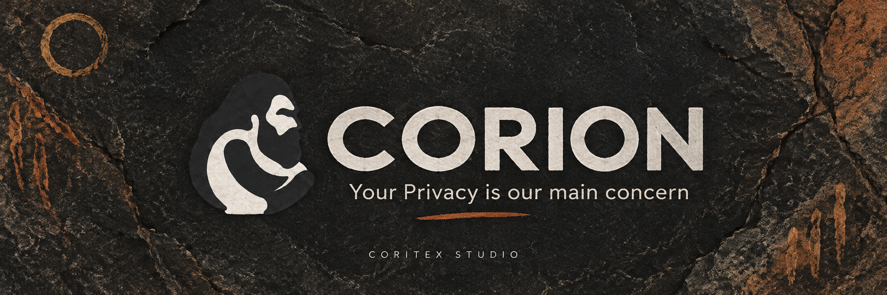
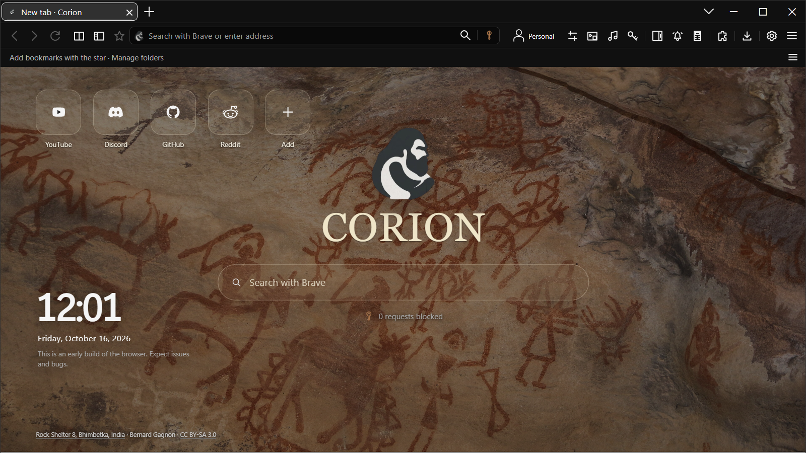
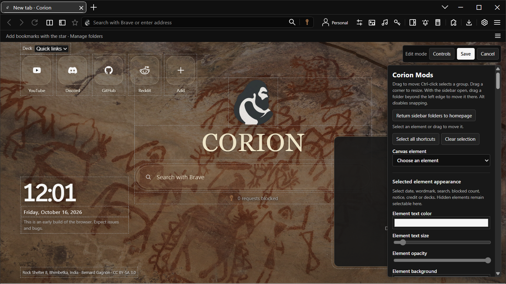
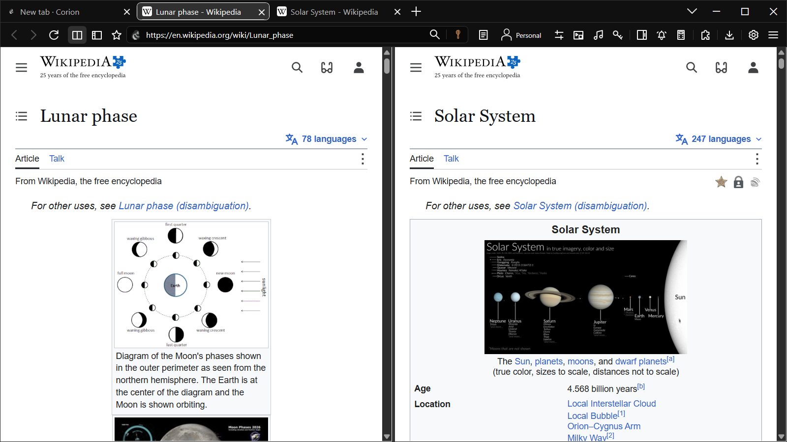
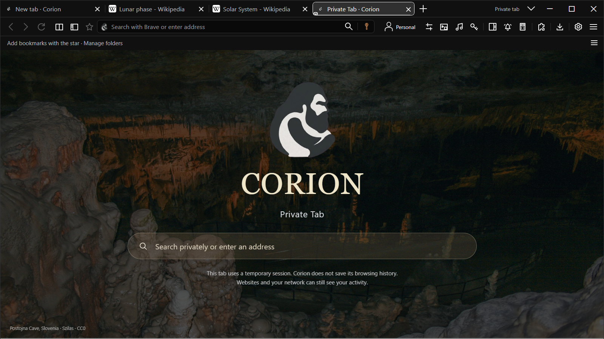

# Corion Browser

**3.24 — Shield Startup Fix · Windows 10 / 11 · x64**

Your Privacy is our main concern

A personal Windows browser by Coritex Studio. Corion combines a live homepage editor with split view, study tools, floating video and visible privacy controls. It is an early preview: expect bugs and incomplete website compatibility.

**New here? [Try one ten-minute task](GET_STARTED.md)** or [help shape Corion](EARLY_TESTERS.md).
The preview download is free and no Corion account is required. The public installer
is **3.24 - Shield Startup Fix**, including the first-document filtering correction.
See the [changelog](CHANGELOG.md) for the changes and verification limits.

[Discuss your setup and first impressions](https://github.com/hithaixo-max/Corion-Browser/discussions).

[**Download Windows installer**](https://github.com/hithaixo-max/Corion-Browser/releases/download/v3.24.0/Corion-3.24.0-win-x64-setup.exe) · [**Download troubleshooter / debugger**](https://github.com/hithaixo-max/Corion-Browser/releases/download/v3.24.0/Corion-3.24.0-troubleshooter.zip) · [Website](https://hithaixo-max.github.io/Corion-Browser/) · [Release notes](https://github.com/hithaixo-max/Corion-Browser/releases/tag/v3.24.0)

[Installer SHA-256](https://github.com/hithaixo-max/Corion-Browser/releases/download/v3.24.0/Corion-3.24.0-win-x64-setup.exe.sha256) · [All release checksums](https://github.com/hithaixo-max/Corion-Browser/releases/download/v3.24.0/SHA256SUMS.txt) · [Watch / download the trailer](https://github.com/hithaixo-max/Corion-Browser/releases/download/v3.23.0/Corion-3.23-trailer-v2.mp4)

The trailer and screenshots were recorded in 3.23; they show the existing interface, not a separate 3.24 recording.

## What is in this repository?

This is Corion's public product, release and feedback space. It contains the website, screenshots, documentation and issue templates. The browser source repository remains private. Download the application and diagnostic toolkit from [Releases](https://github.com/hithaixo-max/Corion-Browser/releases); neither is stored in the website's Git history.

| Guide | What it covers |
| --- | --- |
| [Installation](INSTALLATION.md) | System requirements, setup, download verification, upgrades and uninstalling |
| [First ten minutes](GET_STARTED.md) | A short introduction to the homepage editor, split view and private tabs |
| [Early testers](EARLY_TESTERS.md) | Try one real task and share voluntary public feedback |
| [Privacy and data](PRIVACY.md) | Profiles, private tabs, sign-ins, search, online features and this website |
| [Troubleshooting](TROUBLESHOOTING.md) | Diagnostic download, startup, media, known issues and bug reports |
| [Keyboard shortcuts](KEYBOARD_SHORTCUTS.md) | Shortcuts supported by the current browser shell |
| [Changelog](CHANGELOG.md) | Public preview and recent browser milestones |
| [Press kit and launch copy](PRESS_KIT.md) | Product facts, screenshots, trailer and ready-to-share announcements |
| [Asset credits](ASSET_CREDITS.md) | Photograph attribution and asset permissions |

## What you can do

| Area | Available in this preview | Practical limits |
| --- | --- | --- |
| **Corion Mods** | Move and resize homepage elements in a live editor. Customize clocks, colors, toolbar icons, tab artwork, shortcut covers and folders. Save or Cancel edits; keep named appearance presets and import/export appearance settings. | Supported local image, GIF and video formats vary. Appearance export is not a complete profile backup. |
| **Tabs and workspace** | Horizontal or optional vertical tabs, pinned tabs, tab previews, a tab chooser, split view, website side panels and tabs across windows. | Some sites or extensions may behave differently from other Chromium browsers. |
| **Study and everyday tools** | Saved study sessions, page-linked notes, research sources, native reminders and a standard/scientific calculator. | Reminder alerts require Corion to be running; missed items are checked when you return. |
| **Floating video** | Resizable windows with compact overlay controls, playback, available next-video controls, vertical volume and fullscreen. | Only supported video is capturable. Protected content may not work. The original media still decodes and supplies audio. |
| **Profiles and sign-ins** | Separate profile spaces, local settings and libraries, and normal website sign-ins that can persist across restarts. | A website can expire its own session. Private tabs do not load normal-profile saved logins. |
| **Corion Shield** | Request blocking and per-site Hunting / Relaxing controls, alongside website permission and history controls. | No blocker catches every ad or tracker. Private browsing is not anonymity. |
| **Search and browsing** | Address suggestions, bookmarks, history, download controls, and Brave Search, DuckDuckGo, Google or a custom HTTPS search provider. | Optional online autocomplete can send typed text to the selected provider. It is disabled in private tabs. |

### Make your homepage your own

Corion Mods changes the workspace in place, so you can see how a clock, folder or new background fits before saving. Use local artwork, supported animated covers and optional ambient audio, then keep a named preset for later.

### Keep sources in sight

Split view puts two pages alongside one another. Page-linked notes, saved study sessions and research sources help you return to a topic without rebuilding your workspace. Native tools and floating supported video keep useful tasks close to your tabs.

### Choose the right browsing space

Normal windows in the same profile share their website session. Separate profiles let you keep accounts and activities apart. Private tabs create isolated temporary sessions with a distinct homepage; saved credentials from your normal profile are unavailable there.

A private tab does not hide your requests from a website, network administrator or internet provider. See the [privacy notes](PRIVACY.md) for the details and limits.

## Install, upgrade or remove Corion

Corion targets **Windows 10 build 19041 or later / Windows 11 x64**. The application uses **.NET 8 Desktop** and the **Microsoft Visual C++ x64 runtime**. Setup checks prerequisites and handles missing runtimes; their installers may need an internet connection and administrator approval. The browser installs for the current Windows account.

1. Download the [3.24.0 setup EXE](https://github.com/hithaixo-max/Corion-Browser/releases/download/v3.24.0/Corion-3.24.0-win-x64-setup.exe). The ZIP is the separate troubleshooter, not the browser.
2. Close existing Corion windows, then run setup and choose the offered shortcuts.
3. To upgrade later, close Corion and run the newer installer. Profiles, extensions and settings are kept.
4. To uninstall, use Windows **Settings → Apps → Installed apps → Corion → Uninstall**. Browsing data and saved logins remain on your Windows account; uninstall does not erase the profile.

Read the [full installation guide](INSTALLATION.md) for checksums, file locations and setup failures. The site does not install updates automatically.

## Know the preview's limits

- **Spotify / protected media:** the shipped CEF engine does not include the licensed codecs and DRM required for full Spotify web playback. Settings offers an explicit **Microsoft Edge** fallback. Edge uses its own account session; signing in to Corion does not sign you in there.
- **Floating video:** availability depends on the site's player and capture path. The original source continues decoding and producing audio. Supported capture may hide its picture; paths that need a visible source keep it visible.
- **Windows Jump List:** a known unresolved issue can affect taskbar items. Use Corion's own menus and tabs when those items are unavailable.
- **Extensions:** compatibility is incomplete. This preview does not promise support for every Chrome extension.
- **Music recognition:** the optional feature uses an unofficial community integration and may break when the service changes. It sends a microphone sample only after the relevant action and permission.
- **Privacy:** history controls and isolated private sessions cannot protect a compromised Windows account or device. The history passcode protects the full Settings history view; address-bar recent suggestions remain available by design.

## Send useful feedback

[Report a bug](https://github.com/hithaixo-max/Corion-Browser/issues/new?template=bug_report.yml) or [suggest an improvement](https://github.com/hithaixo-max/Corion-Browser/issues/new?template=feature_request.yml). Include the Corion version from **Settings → About**, Windows version, steps to reproduce, expected result and actual result. The [troubleshooting guide](TROUBLESHOOTING.md) explains the separate diagnostic toolkit.

Review and redact every attachment before posting. Never upload passwords, cookies, tokens, account databases or complete browser profiles. GitHub issues and attachments are public. No dedicated confidential security reporting channel is configured here; do not post sensitive exploit details publicly.

## Rights and credits

Corion's source repository remains private. Original Corion branding and new original product content are reserved by their rights holders. Existing third-party licenses and permissions for legacy material continue to apply; see [LICENSE.txt](LICENSE.txt). This release does not withdraw earlier grants or relicense material owned by others.

Screenshots include a Bhimbetka photograph by **Bernard Gagnon**, licensed **CC BY-SA 3.0**. Coritex Studio does not claim exclusive rights to that photograph or its appearance within screenshots. [Asset credits and source](ASSET_CREDITS.md) provide attribution and license links. Chromium / CEF, CefSharp and other third-party components keep their own licenses and notices, supplied with the browser. Third-party names describe compatibility and do not imply endorsement.
