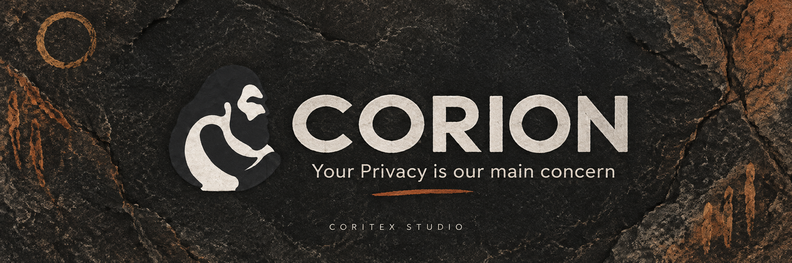

# Corion Browser

**4.0 — Finishing Touches · Windows 10 / 11 · x64**

A personal Windows browser by Coritex Studio, with a customizable homepage, split view, research tools and visible privacy controls. This is an early release with incomplete website compatibility.

[Download the installer](https://github.com/hithaixo-max/Corion-Browser/releases/download/v4.0.0/Corion-4.0.0-win-x64-setup.exe) · [Website](https://hithaixo-max.github.io/Corion-Browser/) · [Release notes](https://github.com/hithaixo-max/Corion-Browser/releases/tag/v4.0.0) · [SHA-256](https://github.com/hithaixo-max/Corion-Browser/releases/download/v4.0.0/Corion-4.0.0-win-x64-setup.exe.sha256)

4.0 adds dormant tab restoration, conservative automatic tab management, a command palette, unified local library, workspaces, offline text reading, setup and selective local backup/recovery tools. It updates the engine to Chromium 156 and the runtime to .NET 10.

[Get started](GET_STARTED.md) · [Installation](INSTALLATION.md) · [Troubleshooting](TROUBLESHOOTING.md) · [Privacy](PRIVACY.md) · [Security](SECURITY.md) · [Changelog](CHANGELOG.md)

The installer is unsigned. Automatic update delivery and remote crash/usage reporting are not deployed. Download future releases manually. This repository hosts product documentation and the website; the browser source remains private. Retained screenshots and trailer footage may show earlier builds. No universal performance, anonymity or compatibility claim is made.
